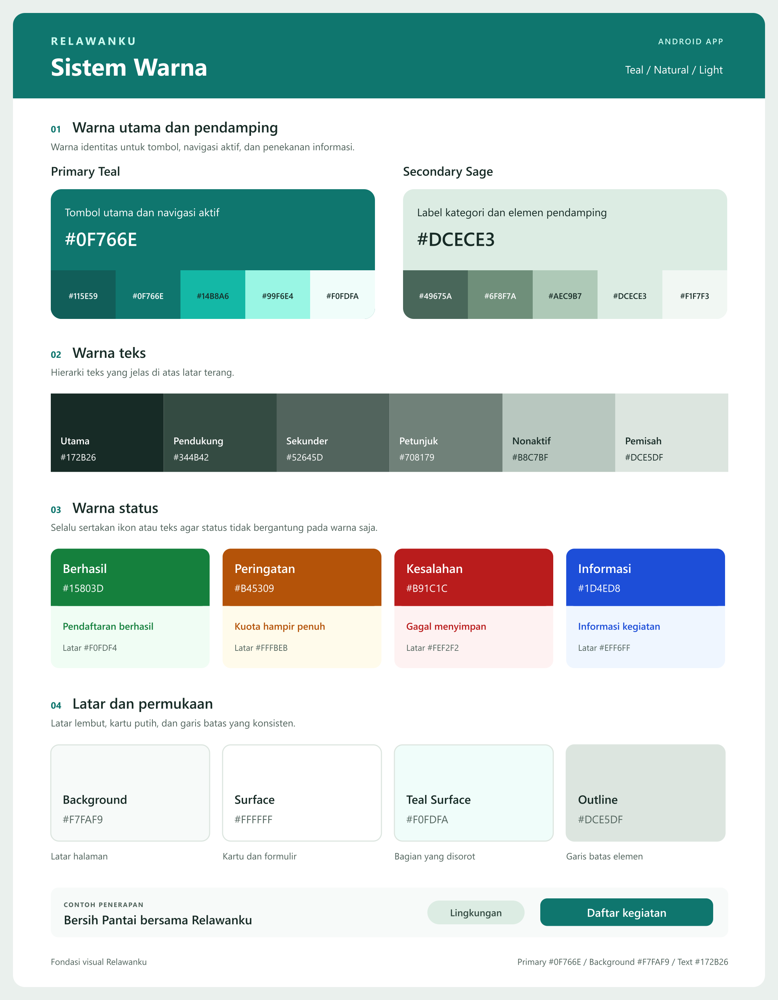

<div align="center">

# 🌱 Relawanku

**Temukan kegiatan. Ambil peran. Hadirkan perubahan.**

Aplikasi Android untuk mempertemukan relawan dengan kegiatan sosial<br>
dan membantu koordinator mengelola kegiatan dalam satu tempat.

**Proyek PAPB** · **Android** · **Kegiatan Sosial**

[Tentang](#tentang-proyek) · [Setup Backend](#menjalankan-backend) · [Dokumentasi](#dokumentasi) · [Desain Visual](#desain-visual)

</div>

---

## Daftar Isi

- [🌱 Relawanku](#-relawanku)
  - [Daftar Isi](#daftar-isi)
  - [Tentang Proyek](#tentang-proyek)
  - [Struktur Repositori](#struktur-repositori)
  - [Backend API](#backend-api)
  - [Menjalankan Backend](#menjalankan-backend)
  - [Dokumentasi](#dokumentasi)
  - [Fitur Aplikasi](#fitur-aplikasi)
  - [Peran dan Hak Akses](#peran-dan-hak-akses)
  - [Navigasi Aplikasi](#navigasi-aplikasi)
  - [Rancangan Halaman](#rancangan-halaman)
    - [Relawan](#relawan)
    - [Koordinator](#koordinator)
    - [Admin](#admin)
  - [Alur Penggunaan](#alur-penggunaan)
    - [Mengikuti kegiatan sebagai relawan](#mengikuti-kegiatan-sebagai-relawan)
    - [Mengelola kegiatan sebagai koordinator](#mengelola-kegiatan-sebagai-koordinator)
  - [Desain Visual](#desain-visual)
  - [Sistem Warna](#sistem-warna)
  - [Tipografi](#tipografi)
    - [Sistem Warna](#sistem-warna)
      - [Warna Utama dan Pendamping](#warna-utama-dan-pendamping)
      - [Warna Teks](#warna-teks)
      - [Warna Status](#warna-status)
      - [Latar dan Permukaan](#latar-dan-permukaan)
      - [Contoh Kombinasi Komponen](#contoh-kombinasi-komponen)
  - [Teknologi dan Alat Kerja](#teknologi-dan-alat-kerja)
  - [Database](#database)

## Tentang Proyek

Relawanku dirancang untuk mendukung perjalanan relawan sejak menemukan kegiatan hingga melihat dokumentasi dan riwayat keikutsertaan. Koordinator dapat mengatur kegiatan, peserta, tugas, dan absensi, sementara admin memiliki akses pengawasan lintas kegiatan.

Seluruh peran menggunakan **satu aplikasi Android**, dengan halaman dan menu yang menyesuaikan peran setelah pengguna masuk.

> **Status repositori:** backend REST API Laravel 13 dan UI Android Kotlin/XML tersedia. UI Android masih memakai data demo lokal; integrasi Retrofit dan autentikasi server menjadi tahap berikutnya.

## Struktur Repositori

Repositori ini menampung backend Laravel, folder pengembangan Android, dan dokumentasi bersama dalam satu riwayat Git.

```text
relawanku/
├── backend/       # Laravel, Composer, migration, dan tes backend
├── android/       # Lokasi proyek Android Studio Kotlin dan XML
├── docs/          # Dokumentasi API dan database bersama
├── postman/       # Koleksi dan environment pengujian
├── scripts/       # Generator kontrak API
└── README.md
```

Buka `backend` di VS Code dan `android` di Android Studio setelah proyek Android dibuat. Semua commit dan push dilakukan melalui repositori induk yang sama, dengan satu folder `.git` di akar proyek.

Folder `android` sudah berisi UI interaktif Kotlin/XML untuk Relawan, Koordinator, dan Admin. Buka folder ini di Android Studio, jalankan `app`, lalu gunakan **Coba dengan data contoh** untuk menjelajahi tampilan. Data UI belum terhubung ke API. Petunjuk dan batas pratinjau ada di [panduan Android](android/README.md).

## Backend API

Backend menggunakan **Laravel 13**, **PHP 8.3+**, **MySQL**, dan autentikasi token **Laravel Sanctum**. Endpoint tersedia melalui prefiks `/api`.

| Keterangan | Nilai |
| --- | --- |
| Lokasi backend | `backend/` |
| Base URL lokal | `http://127.0.0.1:8000/api` |
| Pemeriksaan aplikasi | `GET /api/health` |
| Autentikasi | `Authorization: Bearer <token>` |
| Document root Laragon | `backend/public/` |

## Menjalankan Backend

Siapkan **PHP 8.3+**, **Composer 2**, dan **MySQL 8.4+**. Jalankan MySQL melalui Laragon, lalu buat database `relawanku` dengan charset `utf8mb4`.

**1. Instal dependensi dari akar repositori.**

```powershell
cd backend
composer install
if (-not (Test-Path .env)) { Copy-Item .env.example .env }
```

**2. Atur koneksi database di `backend/.env`.**

Sesuaikan `DB_HOST`, `DB_PORT`, `DB_DATABASE`, `DB_USERNAME`, dan `DB_PASSWORD` dengan konfigurasi MySQL lokal. Jalankan perintah berikut hanya jika `APP_KEY` masih kosong:

```powershell
php artisan key:generate
```

**3. Jalankan migration dan server dari folder `backend`.**

```powershell
php artisan migrate
php artisan storage:link
php artisan serve
```

Untuk menambahkan data contoh lokal, jalankan seeder secara opsional:

```powershell
php artisan db:seed --class=DemoSeeder
```

Seeder tersedia untuk lingkungan `local` atau `testing`. Untuk mencoba API, impor koleksi dan environment Postman, lalu jalankan folder **01 Alur utama**. Sesuaikan email akun dan password environment dengan akun lokal yang digunakan.

Pengujian backend dapat dijalankan dari folder yang sama:

```powershell
php artisan test --compact
```

Panduan konfigurasi dan integrasi Android tersedia di [docs/API.md](docs/API.md). Catatan hasil pengujian beserta kendala yang sudah diketahui ada di [todo.md](todo.md).

## Dokumentasi

| Panduan / berkas | Isi |
| --- | --- |
| [Panduan REST API](docs/API.md) | Setup Laragon, autentikasi, endpoint, dan integrasi Android. |
| [Dokumentasi database](docs/DATABASE.md) | Kolom, relasi, aturan data, dan penjelasan data demo. |
| [OpenAPI JSON](docs/openapi.json) | Kontrak REST API untuk diimpor ke alat dokumentasi atau pengujian. |
| [Koleksi Postman](postman/Relawanku.postman_collection.json) | Alur pengujian otomatis dan referensi endpoint. |
| [Environment Postman](postman/Relawanku.local.postman_environment.json) | Base URL lokal, akun, token, dan ID objek pengujian. |
| [Panduan Android](android/README.md) | Pembuatan proyek Kotlin/XML dan koneksi ke backend. |
| [Checklist dan bukti pengujian](todo.md) | Tahap implementasi, hasil verifikasi, dan pekerjaan lanjutan. |

## Fitur Aplikasi

Backend menyediakan API untuk fitur berikut. Tampilan dan interaksi Android mengikuti rancangan pada bagian selanjutnya.

| Fitur | Gambaran penggunaan |
| --- | --- |
| **Jelajahi kegiatan** | Temukan kegiatan melalui foto, jadwal, lokasi, pencarian, dan filter. |
| **Pendaftaran relawan** | Baca persyaratan dan sisa kuota sebelum mendaftar kegiatan. |
| **Pengelolaan kegiatan** | Buat dan perbarui kegiatan, atur kuota, serta kelola peserta. |
| **Pembagian tugas** | Koordinator membagikan tugas yang dapat dilihat relawan pada kegiatan terkait. |
| **Absensi kegiatan** | Koordinator membuka absensi dan relawan mencatat kehadirannya. |
| **Dokumentasi dan riwayat** | Lihat dokumentasi kegiatan serta riwayat keikutsertaan relawan. |
| **Administrasi pengguna** | Admin mengelola akun, menetapkan koordinator, dan memantau kegiatan. |

## Peran dan Hak Akses

| Peran | Tanggung jawab | Batas akses |
| --- | --- | --- |
| **Relawan** | Mencari dan mendaftar kegiatan, melihat tugas, melakukan absensi, serta melihat dokumentasi dan riwayat keikutsertaan. | Mengakses data keikutsertaan sendiri. |
| **Koordinator** | Membuat kegiatan, mengatur kuota, mengelola peserta, membagi tugas, membuka absensi, dan mengunggah dokumentasi. | Mengelola kegiatan yang menjadi tanggung jawabnya. |
| **Admin** | Mengelola akun, menetapkan koordinator, memantau seluruh kegiatan, dan menangani kegiatan bermasalah. | Memiliki akses pengawasan lintas kegiatan. |

## Navigasi Aplikasi

Rancangan menu utama disesuaikan dengan kebutuhan setiap peran.

| Peran | Menu utama |
| --- | --- |
| Relawan | Beranda · Jelajahi · Kegiatanku · Profil |
| Koordinator | Dashboard · Kelola Kegiatan · Profil |
| Admin | Dashboard · Pengguna · Semua Kegiatan · Profil |

## Rancangan Halaman

### Relawan

Tampilan relawan berfokus pada pencarian kegiatan sosial yang ramah, visual, dan mudah digunakan. Navigasi bawah terdiri dari **Beranda**, **Jelajahi**, **Kegiatanku**, dan **Profil**.

| Halaman | Isi dan interaksi |
| --- | --- |
| **Beranda** | Sapaan, kegiatan terdekat, kegiatan yang sedang diikuti, dan tugas berikutnya. |
| **Jelajahi Kegiatan** | Kartu kegiatan berisi foto, nama, tanggal, lokasi, dan sisa kuota, dilengkapi pencarian serta filter. |
| **Detail Kegiatan** | Deskripsi, jadwal, persyaratan, kuota, dan tombol **Daftar kegiatan**. |
| **Kegiatanku** | Kegiatan yang diikuti, tugas yang diberikan, tombol absensi, dan riwayat keikutsertaan. |
| **Profil** | Identitas relawan dan tombol keluar. |

### Koordinator

Tampilan koordinator berfokus pada pengelolaan kegiatan dan tetap nyaman digunakan melalui ponsel.

| Halaman | Isi dan interaksi |
| --- | --- |
| **Dashboard** | Ringkasan jumlah kegiatan aktif, peserta terdaftar, dan kehadiran. Setiap ringkasan dapat dibuka untuk melihat detail. |
| **Kelola Kegiatan** | Daftar kegiatan dengan tombol tambah, edit, hapus, dan pilihan hapus massal. |
| **Detail Pengelolaan** | Bagian **Ringkasan**, **Peserta**, **Tugas**, **Absensi**, dan **Dokumentasi**. |
| **Profil** | Identitas koordinator dan tombol keluar. |

Peserta, tugas, absensi, dan dokumentasi dikelola di dalam kegiatan terkait. Sebagai contoh, koordinator membuka kegiatan **Bersih Pantai**, lalu mengatur peserta dan tugas untuk kegiatan tersebut.

### Admin

Tampilan admin berfokus pada pengelolaan pengguna dan pengawasan seluruh kegiatan.

| Halaman | Isi dan interaksi |
| --- | --- |
| **Dashboard** | Ringkasan pengguna dan kegiatan untuk membantu pengawasan. |
| **Pengguna** | Pengelolaan akun dan penetapan koordinator. |
| **Semua Kegiatan** | Pemantauan kegiatan lintas koordinator dan penanganan kegiatan bermasalah. |
| **Profil** | Identitas admin dan tombol keluar. |

## Alur Penggunaan

### Mengikuti kegiatan sebagai relawan

1. Menemukan kegiatan melalui beranda atau halaman jelajah.
2. Membaca deskripsi, jadwal, lokasi, persyaratan, dan sisa kuota.
3. Mendaftar dan membuka kegiatan melalui **Kegiatanku**.
4. Melihat tugas yang diberikan koordinator.
5. Melakukan absensi saat kegiatan berlangsung.
6. Melihat dokumentasi dan riwayat keikutsertaan.

### Mengelola kegiatan sebagai koordinator

1. Membuat kegiatan dan menentukan jadwal, persyaratan, serta kuota.
2. Memantau dan mengelola peserta yang terdaftar.
3. Membagikan tugas kepada relawan.
4. Membuka absensi dan memantau kehadiran.
5. Mengunggah dokumentasi kegiatan.

## Desain Visual

Antarmuka dirancang agar ramah untuk relawan dan praktis untuk pengelola kegiatan.

| Elemen | Arah desain |
| --- | --- |
| **Warna** | Primary Teal `#0F766E` dan Secondary Sage `#DCECE3`, dipadukan dengan permukaan putih dan teks gelap. |
| **Tipografi** | Nunito dengan ketebalan Regular, SemiBold, dan Bold sesuai fungsi teks. |
| **Kartu kegiatan** | Foto dan informasi utama yang membantu relawan memilih kegiatan. |
| **Status** | Label yang mudah dikenali: **Pendaftaran dibuka**, **Kuota penuh**, **Sudah terdaftar**, dan **Selesai**. |
| **Aksi utama** | Satu tombol yang menonjol pada setiap halaman, seperti **Daftar kegiatan** atau **Buka absensi**. |
| **Dashboard** | Ringkasan yang mudah dipindai; grafik digunakan jika membantu memahami data. |

### Sistem Warna

Palet menggunakan teal sebagai identitas utama, sage sebagai warna pendamping, dan latar terang untuk menjaga keterbacaan.

<details>
<summary>Lihat gambar panduan sistem warna</summary>



</details>

#### Warna Utama dan Pendamping

| Warna | Kode HEX | Penggunaan |
| --- | --- | --- |
| Teal gelap | `#115E59` | Kondisi tombol ditekan. |
| **Primary Teal** | `#0F766E` | Tombol utama, navigasi aktif, dan identitas aplikasi. |
| Teal cerah | `#14B8A6` | Aksen dan elemen dekoratif. |
| Teal muda | `#99F6E4` | Penekanan visual ringan. |
| Teal sangat muda | `#F0FDFA` | Latar bagian yang disorot. |
| Sage gelap | `#49675A` | Ikon atau aksen pendamping. |
| Sage sedang | `#6F8F7A` | Elemen dekoratif pendamping. |
| Sage muda | `#AEC9B7` | Penekanan visual ringan. |
| **Secondary Sage** | `#DCECE3` | Latar label kategori dan tombol sekunder. |
| Sage sangat muda | `#F1F7F3` | Latar bagian pendamping. |

#### Warna Teks

| Elemen | Kode HEX | Penggunaan |
| --- | --- | --- |
| Teks utama | `#172B26` | Judul, nama kegiatan, dan informasi penting. |
| Teks pendukung | `#344B42` | Deskripsi dan label formulir. |
| Teks sekunder | `#52645D` | Tanggal, lokasi, dan keterangan tambahan. |
| Teks petunjuk | `#708179` | Petunjuk ringan; periksa kontras pada ukuran kecil. |
| Teks nonaktif | `#B8C7BF` | Elemen yang tidak dapat digunakan. |
| Pemisah | `#DCE5DF` | Garis pembatas, bukan teks informasi. |

#### Warna Status

| Status | Warna utama | Warna latar | Contoh penggunaan |
| --- | --- | --- | --- |
| Berhasil | `#15803D` | `#F0FDF4` | Pendaftaran berhasil atau absensi tercatat. |
| Peringatan | `#B45309` | `#FFFBEB` | Kuota hampir penuh. |
| Kesalahan | `#B91C1C` | `#FEF2F2` | Gagal menyimpan atau validasi bermasalah. |
| Informasi | `#1D4ED8` | `#EFF6FF` | Informasi dan petunjuk kegiatan. |

Gunakan warna status bersama teks atau ikon agar maknanya tetap jelas.

#### Latar dan Permukaan

| Elemen | Kode HEX | Penggunaan |
| --- | --- | --- |
| Background | `#F7FAF9` | Latar utama halaman. |
| Surface | `#FFFFFF` | Kartu kegiatan, formulir, dan dialog. |
| Teal Surface | `#F0FDFA` | Ringkasan atau bagian yang disorot. |
| Outline | `#DCE5DF` | Garis batas dan pemisah. |

#### Contoh Kombinasi Komponen

| Komponen | Latar | Teks atau ikon |
| --- | --- | --- |
| Tombol utama **Daftar kegiatan** | `#0F766E` | `#FFFFFF` |
| Tombol utama saat ditekan | `#115E59` | `#FFFFFF` |
| Tombol sekunder | `#DCECE3` | `#344B42` |
| Label kategori **Lingkungan** | `#DCECE3` | `#344B42` |
| Kartu kegiatan | `#FFFFFF` | `#172B26` |
| Navigasi aktif | `#DCECE3` | `#0F766E` |
| Pesan kesalahan | `#FEF2F2` | `#B91C1C` |

### Tipografi

Rancangan tipografi menggunakan **Nunito** untuk judul, isi, label, dan navigasi. Ukuran teks dan tinggi baris berikut menjadi acuan tampilan Android dalam satuan `sp`.

| Elemen | Font | Ketebalan | Ukuran Android | Tinggi baris |
| --- | --- | --- | --- | --- |
| Judul pembuka | Nunito | Bold · 700 | `28 sp` | `36 sp` |
| Judul halaman | Nunito | Bold · 700 | `24 sp` | `32 sp` |
| Judul bagian | Nunito | Bold · 700 | `20 sp` | `28 sp` |
| Judul kartu kegiatan | Nunito | Bold · 700 | `18 sp` | `26 sp` |
| Deskripsi utama | Nunito | Regular · 400 | `16 sp` | `24 sp` |
| Label formulir | Nunito | SemiBold · 600 | `14 sp` | `20 sp` |
| Tanggal, lokasi, keterangan | Nunito | Regular · 400 | `14 sp` | `20 sp` |
| Teks tombol | Nunito | Bold · 700 | `16 sp` | `24 sp` |
| Label status dan navigasi | Nunito | SemiBold · 600 | `12 sp` | `16 sp` |

## Teknologi dan Alat Kerja

Backend Laravel dan autentikasi Sanctum sudah digunakan pada proyek. Teknologi Android serta alat desain, kolaborasi, dan pelaporan berikut menjadi acuan pengembangan tim.

| Kebutuhan | Pilihan teknologi / alat |
| --- | --- |
| **Aplikasi Android** | Android Studio, Kotlin, dan XML |
| **Koneksi Android ke API** | Retrofit |
| **Backend API** | Laravel, PHP, Composer, dan VS Code |
| **Server dan database lokal** | Laragon dan MySQL; phpMyAdmin untuk inspeksi database |
| **Autentikasi API** | Laravel Sanctum |
| **Pengujian API** | Postman |
| **Rancangan layar** | Figma |
| **ERD dan use case** | draw.io |
| **Kolaborasi kode** | Git dan GitHub; GitHub Desktop bila diperlukan |
| **Pembagian pekerjaan** | GitHub Projects |
| **Laporan** | Microsoft Word |
| **Poster dan flyer** | Canva |
| **Video demonstrasi** | OBS Studio untuk merekam dan CapCut untuk menyunting |

<details>
<summary>Lihat gambar referensi pilihan alat kerja</summary>


</details>

## Database

Database mencakup akun, kegiatan, pendaftaran, tugas, sesi absensi, kehadiran, dokumentasi, dan riwayat aktivitas.

| Tabel | Fungsi |
| --- | --- |
| `users` | Menyimpan akun dan peran pengguna. |
| `activities` | Menyimpan kegiatan dan kuota peserta. |
| `registrations` | Menghubungkan relawan dengan kegiatan yang diikuti. |
| `tasks` | Menyimpan tugas kegiatan dan penanggung jawab. |
| `attendances` | Menyimpan kehadiran peserta. |
| `documentations` | Menyimpan foto dan keterangan dokumentasi kegiatan. |
| `attendance_sessions` | Menyimpan sesi absensi dan hash kode yang memiliki masa berlaku. |
| `activity_logs` | Mencatat aksi pengelolaan kegiatan dan akun. |

Migration, model, dan aturan API sudah mencakup tabel tersebut. Rincian kolom, relasi, dan data contoh tersedia di [dokumentasi database](docs/DATABASE.md).
