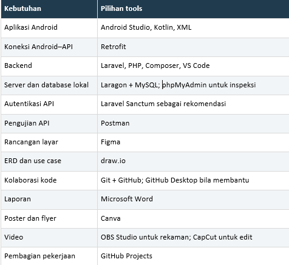

<div align="center">

# 🌱 Relawanku

**Temukan kegiatan. Ambil peran. Hadirkan perubahan.**

Aplikasi Android untuk mempertemukan relawan dengan kegiatan sosial\
dan membantu koordinator mengelola kegiatan dalam satu tempat.

**Proyek PAPB** · **Android** · **Kegiatan Sosial**

[Tentang](#tentang-proyek) · [Fitur](#fitur-yang-direncanakan) · [Peran](#peran-dan-hak-akses) · [Teknologi](#rencana-teknologi-dan-alat-kerja)

</div>

---

## Tentang Proyek

Relawanku dirancang untuk mendukung perjalanan relawan sejak menemukan kegiatan hingga melihat dokumentasi dan riwayat keikutsertaan. Koordinator dapat mengatur kegiatan, peserta, tugas, dan absensi, sementara admin memiliki akses pengawasan lintas kegiatan.

Seluruh peran menggunakan **satu aplikasi Android**, dengan halaman dan menu yang menyesuaikan peran setelah pengguna masuk.

> **Status repositori:** backend REST API Laravel 13 tersedia. Aplikasi Android dan rancangan antarmukanya menjadi tahap pengembangan berikutnya.

## Struktur Repository

Repository GitHub ini memuat backend Laravel dan tempat proyek Android dalam satu riwayat Git.

```text
relawanku/
├── backend/       # Laravel, Composer, migration, dan tes backend
├── android/       # Lokasi proyek Android Studio Kotlin dan XML
├── docs/          # Dokumentasi API dan database bersama
├── postman/       # Koleksi dan environment pengujian
├── scripts/       # Generator kontrak API
└── README.md
```

Buka `backend` di VS Code dan `android` di Android Studio setelah proyek Android dibuat. Semua commit dan push dilakukan ke repository induk yang sama; jangan membuat `.git` kedua di dalam `android` atau `backend`.

Folder `android` saat ini disiapkan untuk proyek baru, belum berisi aplikasi atau APK. Langkah pembuatannya ada di [panduan Android](android/README.md).

## Backend API

Backend menggunakan **Laravel 13**, **PHP 8.3+**, **MySQL**, dan token **Laravel Sanctum**. Semua endpoint berada di `/api`; proyek ini tidak memerlukan build frontend.

| Panduan / berkas | Isi |
| --- | --- |
| [Panduan REST API](docs/API.md) | Setup Laragon, autentikasi, seluruh endpoint, dan integrasi Android. |
| [Rancangan database](docs/DATABASE.md) | Kolom, relasi, aturan data, dan akun demo lokal. |
| [OpenAPI JSON](docs/openapi.json) | Kontrak REST API untuk impor ke alat dokumentasi/pengujian. |
| [Koleksi Postman](postman/Relawanku.postman_collection.json) | Alur pengujian otomatis dan referensi endpoint. |
| [Environment Postman](postman/Relawanku.local.postman_environment.json) | Base URL lokal, akun demo, token, dan ID objek. |
| [Checklist dan bukti pengujian](todo.md) | Tahap implementasi serta hasil verifikasi. |

Dari folder `backend`, setelah MySQL aktif dan database `relawanku` tersedia, siapkan `.env` dari `.env.example` dan sesuaikan koneksi database. Pada instalasi baru, jalankan `composer install` dan `php artisan key:generate` jika `APP_KEY` masih kosong. Kemudian:

```powershell
cd backend
php artisan migrate
php artisan db:seed --class=DemoSeeder
php artisan storage:link
php artisan serve
```

Data demo bersifat opsional dan hanya untuk lingkungan lokal/pengujian. Impor koleksi serta environment Postman, lalu jalankan folder **01 Alur utama**. Panduan lengkap tersedia di [docs/API.md](docs/API.md).

## Daftar Isi

- [Backend API](#backend-api)
- [Fitur yang Direncanakan](#fitur-yang-direncanakan)
- [Peran dan Hak Akses](#peran-dan-hak-akses)
- [Navigasi Aplikasi](#navigasi-aplikasi)
- [Rancangan Halaman](#rancangan-halaman)
- [Alur Penggunaan](#alur-penggunaan)
- [Arah Desain Visual](#arah-desain-visual)
- [Rencana Teknologi dan Alat Kerja](#rencana-teknologi-dan-alat-kerja)
- [Rancangan Database](#rancangan-database)

## Fitur yang Direncanakan

| Fitur | Gambaran penggunaan |
| --- | --- |
| **Jelajahi kegiatan** | Temukan kegiatan melalui foto, jadwal, lokasi, pencarian, dan filter. |
| **Pendaftaran relawan** | Baca persyaratan dan sisa kuota sebelum mendaftar kegiatan. |
| **Pengelolaan kegiatan** | Buat dan perbarui kegiatan, atur kuota, serta kelola peserta. |
| **Pembagian tugas** | Koordinator membagikan tugas yang dapat dilihat relawan pada kegiatan terkait. |
| **Absensi kegiatan** | Koordinator membuka absensi dan relawan mencatat kehadirannya. |
| **Dokumentasi dan riwayat** | Lihat dokumentasi kegiatan serta riwayat keikutsertaan relawan. |
| **Administrasi pengguna** | Admin mengelola akun, menetapkan koordinator, dan memantau kegiatan. |

## Peran dan Hak Akses

| Peran | Tanggung jawab | Batas akses |
| --- | --- | --- |
| **Relawan** | Mencari dan mendaftar kegiatan, melihat tugas, melakukan absensi, serta melihat dokumentasi dan riwayat keikutsertaan. | Mengakses data keikutsertaan sendiri. |
| **Koordinator** | Membuat kegiatan, mengatur kuota, mengelola peserta, membagi tugas, membuka absensi, dan mengunggah dokumentasi. | Mengelola kegiatan yang menjadi tanggung jawabnya. |
| **Admin** | Mengelola akun, menetapkan koordinator, memantau seluruh kegiatan, dan menangani kegiatan bermasalah. | Memiliki akses pengawasan lintas kegiatan. |

## Navigasi Aplikasi

Menu utama disesuaikan dengan kebutuhan setiap peran.

| Peran | Menu utama |
| --- | --- |
| Relawan | Beranda · Jelajahi · Kegiatanku · Profil |
| Koordinator | Dashboard · Kelola Kegiatan · Profil |
| Admin | Dashboard · Pengguna · Semua Kegiatan · Profil |

## Rancangan Halaman

### Relawan

Tampilan relawan berfokus pada pencarian kegiatan sosial yang ramah, visual, dan mudah digunakan. Navigasi bawah terdiri dari **Beranda**, **Jelajahi**, **Kegiatanku**, dan **Profil**.

| Halaman | Isi dan interaksi |
| --- | --- |
| **Beranda** | Sapaan, kegiatan terdekat, kegiatan yang sedang diikuti, dan tugas berikutnya. |
| **Jelajahi Kegiatan** | Kartu kegiatan berisi foto, nama, tanggal, lokasi, dan sisa kuota, dilengkapi pencarian serta filter. |
| **Detail Kegiatan** | Deskripsi, jadwal, persyaratan, kuota, dan tombol **Daftar kegiatan**. |
| **Kegiatanku** | Kegiatan yang diikuti, tugas yang diberikan, tombol absensi, dan riwayat keikutsertaan. |
| **Profil** | Identitas relawan dan tombol keluar. |

### Koordinator

Tampilan koordinator berfokus pada pengelolaan kegiatan dan tetap nyaman digunakan melalui ponsel.

| Halaman | Isi dan interaksi |
| --- | --- |
| **Dashboard** | Ringkasan jumlah kegiatan aktif, peserta terdaftar, dan kehadiran. Setiap ringkasan dapat dibuka untuk melihat detail. |
| **Kelola Kegiatan** | Daftar kegiatan dengan tombol tambah, edit, hapus, dan pilihan hapus massal. |
| **Detail Pengelolaan** | Bagian **Ringkasan**, **Peserta**, **Tugas**, **Absensi**, dan **Dokumentasi**. |
| **Profil** | Identitas koordinator dan tombol keluar. |

Peserta, tugas, absensi, dan dokumentasi dikelola di dalam kegiatan terkait. Sebagai contoh, koordinator membuka kegiatan **Bersih Pantai**, lalu mengatur peserta dan tugas untuk kegiatan tersebut.

### Admin

Tampilan admin berfokus pada pengelolaan pengguna dan pengawasan seluruh kegiatan.

| Halaman | Isi dan interaksi |
| --- | --- |
| **Dashboard** | Ringkasan pengguna dan kegiatan untuk membantu pengawasan. |
| **Pengguna** | Pengelolaan akun dan penetapan koordinator. |
| **Semua Kegiatan** | Pemantauan kegiatan lintas koordinator dan penanganan kegiatan bermasalah. |
| **Profil** | Identitas admin dan tombol keluar. |

## Alur Penggunaan

### Mengikuti kegiatan sebagai relawan

1. Menemukan kegiatan melalui beranda atau halaman jelajah.
2. Membaca deskripsi, jadwal, lokasi, persyaratan, dan sisa kuota.
3. Mendaftar dan membuka kegiatan melalui **Kegiatanku**.
4. Melihat tugas yang diberikan koordinator.
5. Melakukan absensi saat kegiatan berlangsung.
6. Melihat dokumentasi dan riwayat keikutsertaan.

### Mengelola kegiatan sebagai koordinator

1. Membuat kegiatan dan menentukan jadwal, persyaratan, serta kuota.
2. Memantau dan mengelola peserta yang terdaftar.
3. Membagikan tugas kepada relawan.
4. Membuka absensi dan memantau kehadiran.
5. Mengunggah dokumentasi kegiatan.

## Arah Desain Visual

Antarmuka dirancang agar ramah untuk relawan dan praktis untuk pengelola kegiatan.

| Elemen | Arah desain |
| --- | --- |
| **Warna** | Hijau atau teal sebagai warna utama, dipadukan dengan latar putih dan teks gelap. |
| **Kartu kegiatan** | Foto dan informasi utama yang membantu relawan memilih kegiatan. |
| **Status** | Label yang mudah dikenali: **Pendaftaran dibuka**, **Kuota penuh**, **Sudah terdaftar**, dan **Selesai**. |
| **Aksi utama** | Satu tombol yang menonjol pada setiap halaman, seperti **Daftar kegiatan** atau **Buka absensi**. |
| **Dashboard** | Ringkasan yang mudah dipindai; grafik digunakan jika membantu memahami data. |

## Rencana Teknologi dan Alat Kerja

Pilihan berikut menjadi acuan perencanaan. Versi dan konfigurasi akan didokumentasikan saat implementasi tersedia.

| Kebutuhan | Pilihan teknologi / alat |
| --- | --- |
| **Aplikasi Android** | Android Studio, Kotlin, dan XML |
| **Koneksi Android ke API** | Retrofit |
| **Backend API** | Laravel, PHP, Composer, dan VS Code |
| **Server dan database lokal** | Laragon dan MySQL; phpMyAdmin untuk inspeksi database |
| **Autentikasi API** | Laravel Sanctum sebagai pilihan yang direkomendasikan |
| **Pengujian API** | Postman |
| **Rancangan layar** | Figma |
| **ERD dan use case** | draw.io |
| **Kolaborasi kode** | Git dan GitHub; GitHub Desktop bila diperlukan |
| **Pembagian pekerjaan** | GitHub Projects |
| **Laporan** | Microsoft Word |
| **Poster dan flyer** | Canva |
| **Video demonstrasi** | OBS Studio untuk merekam dan CapCut untuk menyunting |

<details>
<summary>Lihat gambar referensi pilihan alat kerja</summary>



</details>

## Rancangan Database

Rancangan awal data mencakup akun, kegiatan, pendaftaran, tugas, kehadiran, dan dokumentasi.

| Tabel | Fungsi |
| --- | --- |
| `users` | Menyimpan akun dan peran pengguna. |
| `activities` | Menyimpan kegiatan dan kuota peserta. |
| `registrations` | Menghubungkan relawan dengan kegiatan yang diikuti. |
| `tasks` | Menyimpan tugas kegiatan dan penanggung jawab. |
| `attendances` | Menyimpan kehadiran peserta. |
| `documentations` | Menyimpan foto dan keterangan dokumentasi kegiatan. |
| `attendance_sessions` | Menyimpan sesi absensi dan hash kode yang memiliki masa berlaku. |
| `activity_logs` | Mencatat aksi pengelolaan kegiatan dan akun. |

Migration, model, dan aturan API sudah mencakup tabel tersebut. Rincian kolom, relasi, dan data contoh tersedia di [dokumentasi database](docs/DATABASE.md).
