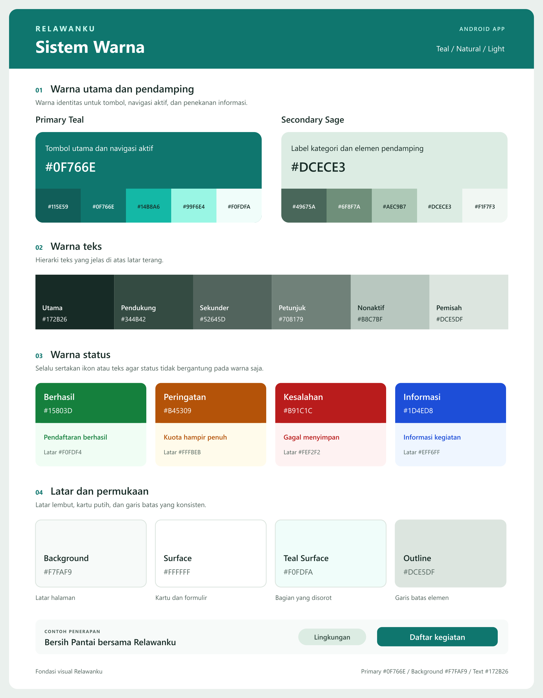
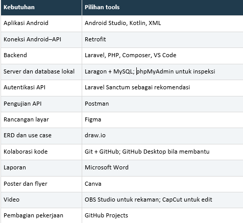

<div align="center">

# 🌱 Relawanku

**Temukan kegiatan. Ambil peran. Hadirkan perubahan.**

Aplikasi Android untuk mempertemukan relawan dengan kegiatan sosial<br>
dan membantu koordinator mengelola kegiatan dalam satu tempat.

**Proyek PAPB** · **Android** · **Kegiatan Sosial**

[Tentang](#tentang-proyek) · [Fitur](#fitur-aplikasi) · [Absensi Kode Sesi](#absensi-kode-sesi) · [Menjalankan Proyek](#menjalankan-backend) · [Dokumentasi](#dokumentasi)

</div>

---

## Daftar Isi

- [Tentang Proyek](#tentang-proyek)
- [Struktur Repositori](#struktur-repositori)
- [Backend API](#backend-api)
- [Menjalankan Backend](#menjalankan-backend)
- [Menjalankan Android](#menjalankan-android)
- [Pengujian dengan Postman](#pengujian-dengan-postman)
- [Koneksi dan Data Uji](#koneksi-dan-data-uji)
- [Pengujian Otomatis](#pengujian-otomatis)
- [Dokumentasi](#dokumentasi)
- [Fitur Aplikasi](#fitur-aplikasi)
- [Absensi Kode Sesi](#absensi-kode-sesi)
- [Peran dan Hak Akses](#peran-dan-hak-akses)
- [Navigasi Aplikasi](#navigasi-aplikasi)
- [Halaman Aplikasi](#halaman-aplikasi)
- [Alur Penggunaan](#alur-penggunaan)
- [Desain Visual](#desain-visual)
  - [Sistem Warna](#sistem-warna)
  - [Tipografi](#tipografi)
- [Teknologi dan Alat Kerja](#teknologi-dan-alat-kerja)
- [Database](#database)

## Tentang Proyek

Relawanku adalah aplikasi Android untuk pendaftaran dan pengelolaan kegiatan relawan. Informasi kegiatan, peserta, tugas, kehadiran, dan dokumentasi tersimpan dalam satu sistem sehingga relawan dan penyelenggara dapat mengikuti perkembangan kegiatan dari aplikasi yang sama.

Relawan dapat mencari kegiatan, mendaftar, melihat tugas, dan mencatat kehadiran. Koordinator mengelola kegiatan yang menjadi tanggung jawabnya, sedangkan admin mengelola akun dan memantau seluruh kegiatan. Menu dan hak akses mengikuti peran akun setelah pengguna masuk.

Aplikasi dikembangkan dengan **Kotlin dan XML**, terhubung melalui **Retrofit** ke **REST API Laravel**, dan menggunakan **MySQL** untuk penyimpanan data. Fitur unggulannya adalah **absensi kode sesi** dengan batas waktu dan validasi peserta di server.

## Struktur Repositori

Kode Android, backend, dan dokumentasi dikelola dalam satu repositori.

```text
relawanku/
├── backend/       # Laravel, Composer, migration, dan tes backend
├── android/       # Aplikasi Android Kotlin dan XML
├── docs/          # Dokumentasi API dan database
├── postman/       # Koleksi dan environment pengujian
├── scripts/       # Generator kontrak API
└── README.md
```

Buka folder `backend` untuk pengembangan API dan folder `android` melalui Android Studio untuk menjalankan aplikasi. Pengelolaan Git dilakukan dari akar repositori.

Halaman pembuka menggunakan layout XML, sedangkan halaman lainnya dibangun melalui komponen tampilan Kotlin. Pengaturan koneksi tersedia pada halaman masuk melalui menu **Atur koneksi server**.

## Backend API

Backend menggunakan **Laravel 13**, **PHP 8.3+**, **MySQL**, dan autentikasi token **Laravel Sanctum**. Endpoint tersedia melalui prefiks `/api`.

Alur komunikasi: **Android → Retrofit → REST API Laravel → MySQL**. Laravel memeriksa token, hak akses, dan data permintaan sebelum mengembalikan respons JSON ke aplikasi.

| Keterangan | Nilai |
| --- | --- |
| Lokasi backend | `backend/` |
| Base URL lokal | `http://127.0.0.1:8000/api` |
| Pemeriksaan aplikasi | `GET /api/health` |
| Autentikasi | `Authorization: Bearer <token>` |
| Document root Laragon | `backend/public/` |

## Menjalankan Backend

Siapkan **PHP 8.3+**, **Composer 2**, dan **MySQL 8.4+**. Jalankan MySQL melalui Laragon, lalu buat database `relawanku` dengan charset `utf8mb4`.

**1. Instal dependensi dari akar repositori.**

```powershell
cd backend
composer install
if (-not (Test-Path .env)) { Copy-Item .env.example .env }
```

**2. Atur koneksi database di `backend/.env`.**

Sesuaikan `DB_HOST`, `DB_PORT`, `DB_DATABASE`, `DB_USERNAME`, dan `DB_PASSWORD` dengan konfigurasi MySQL lokal. Jalankan perintah berikut hanya jika `APP_KEY` masih kosong:

```powershell
php artisan key:generate
```

**3. Jalankan migration dan server dari folder `backend`.**

```powershell
php artisan migrate
php artisan storage:link
php artisan serve --host=0.0.0.0 --port=8000
```

Biarkan terminal server tetap berjalan selama menggunakan Android atau Postman. Periksa koneksi melalui `GET http://127.0.0.1:8000/api/health`; respons yang diharapkan adalah HTTP 200 dengan pesan `Relawanku API siap.`.

Untuk menambahkan data contoh pada lingkungan `local` atau `testing`, jalankan perintah berikut dari terminal lain di folder `backend`:

```powershell
php artisan db:seed --class=DemoSeeder
```

Seeder membuat akun `admin@gmail.com`, `koordinator@gmail.com`, dan `relawan@gmail.com` jika belum ada, dengan password awal dari `DEMO_PASSWORD`. Nama, password, dan peran akun yang sudah ada dipertahankan. Akun lokal yang pernah diubah dapat berbeda dari akun awal seeder.

## Menjalankan Android

1. Pastikan MySQL dan server Laravel sudah berjalan.
2. Buka folder `android` melalui Android Studio. Siapkan Android SDK yang diminta proyek dan JDK 21, lalu lakukan Gradle Sync.
3. Jalankan aplikasi pada emulator atau ponsel. Aplikasi menetapkan minimum SDK 24.
4. Pada halaman masuk, buka **Atur koneksi server** dan pilih alamat sesuai perangkat:

| Perangkat | Alamat API |
| --- | --- |
| Emulator Android Studio | `http://10.0.2.2:8000/api/` |
| Ponsel melalui Wi-Fi yang sama | `http://IP-LAPTOP:8000/api/` |
| Emulator atau ponsel melalui ADB reverse | `http://127.0.0.1:8000/api/` |

Untuk koneksi USB melalui ADB reverse, jalankan:

```powershell
adb reverse tcp:8000 tcp:8000
```

Gunakan alamat API dengan akhiran `/`, lalu masuk dengan akun yang tersimpan di server. Pendaftaran mandiri membuat akun Relawan; akun Koordinator dibuat oleh Admin. Panduan build, koneksi, dan tes perangkat tersedia di [android/README.md](android/README.md).

## Pengujian dengan Postman

1. Jalankan MySQL dan Laravel, lalu pastikan `/api/health` dapat diakses.
2. Impor koleksi dan environment dari folder `postman`.
3. Pilih environment **Relawanku - Local**. Periksa `base_url`, email, dan password agar sesuai dengan server serta akun yang digunakan.
4. Pilih satu folder melalui Collection Runner:

| Folder | Penggunaan |
| --- | --- |
| **00 Data saat ini - baca saja** | Login dan membaca data yang sudah ada. Sesuaikan ID kegiatan pilihan pada environment dengan database lokal. |
| **01 Alur utama - jalankan folder ini** | Membuat kegiatan dan tugas uji, mendaftarkan relawan, melakukan absensi, lalu mengarsipkan data uji. |
| **02 Referensi endpoint - jalankan satu per satu** | Menjalankan endpoint secara manual sesuai akun, ID data, dan prasyaratnya. |

Jalankan satu folder pada setiap pengujian. Token, ID hasil pembuatan data, dan kode absensi diisi otomatis dari respons API. Folder 01 membuat jadwal kegiatan relatif terhadap waktu eksekusi agar alurnya dapat diulang.

Request berlabel **Uji 403/404/409** memang mengharapkan penolakan tersebut. Hasil dinilai dari kesesuaian respons dengan tes, bukan hanya kode HTTP. Unggahan foto dijalankan manual dengan memilih berkas pada **Body > form-data > image**.

Langkah demo dan penjelasan variabel tersedia di [postman/README.md](postman/README.md).

## Koneksi dan Data Uji

| Kondisi | Pemeriksaan |
| --- | --- |
| Request **Status API** tidak tersambung | Pastikan proses Laravel masih berjalan dan host serta port pada `base_url` sesuai. Impor koleksi tidak menjalankan server. |
| Login ditolak | Periksa akun pada database dan nilai email/password di environment. Seeder tidak mengatur ulang password akun yang sudah ada. |
| Pendaftaran ditolak | Periksa status kegiatan, batas pendaftaran, waktu mulai, kuota, dan apakah relawan sudah terdaftar. |
| Absensi ditolak | Pastikan kegiatan sedang berlangsung, peserta masih aktif, sesi belum ditutup, dan kode belum kedaluwarsa. |
| Foto tidak tampil | Periksa tautan `public/storage` dan pastikan alamat media dapat dijangkau dari perangkat Android. |

Data kegiatan contoh memakai jadwal saat pertama dibuat. Menjalankan ulang seeder tidak menggeser jadwal tersebut. Gunakan kegiatan uji baru untuk mencoba pendaftaran dan absensi pada tanggal yang berbeda.

## Pengujian Otomatis

Jalankan tes backend dari folder `backend`:

```powershell
php artisan test --compact
```

Dari folder `android`, jalankan build, unit test, dan lint:

```powershell
.\gradlew.bat :app:assembleDebug :app:testDebugUnitTest :app:lintDebug
```

Tes antarmuka memerlukan emulator atau perangkat Android yang terhubung:

```powershell
.\gradlew.bat :app:connectedDebugAndroidTest
```

Tes backend mencakup autentikasi, hak akses, validasi, kuota, pendaftaran, tugas, dan absensi. Tes Android mencakup komunikasi API, penyimpanan sesi, serta interaksi antarmuka. Konfigurasi tes integrasi tersedia di [panduan Android](android/README.md); hasil pengujian yang telah dicatat tersedia di [todo.md](todo.md).

## Dokumentasi

| Panduan / berkas | Isi |
| --- | --- |
| [Panduan REST API](docs/API.md) | Setup Laragon, autentikasi, endpoint, dan integrasi Android. |
| [Dokumentasi database](docs/DATABASE.md) | Kolom, relasi, aturan data, dan penjelasan data demo. |
| [OpenAPI JSON](docs/openapi.json) | Kontrak REST API untuk diimpor ke alat dokumentasi atau pengujian. |
| [Koleksi Postman](postman/Relawanku.postman_collection.json) | Alur pengujian otomatis dan referensi endpoint. |
| [Environment Postman](postman/Relawanku.local.postman_environment.json) | Base URL lokal, akun, token, dan ID objek pengujian. |
| [Panduan demo Postman](postman/README.md) | Persiapan server, pilihan alur demo, variabel, dan pembacaan hasil tes. |
| [Panduan Android](android/README.md) | Menjalankan aplikasi, mengatur koneksi, build, dan pengujian. |
| [Checklist dan bukti pengujian](todo.md) | Tahap implementasi, hasil verifikasi, dan pekerjaan lanjutan. |

## Fitur Aplikasi

Fitur berikut tersedia melalui aplikasi Android dan REST API Laravel.

| Fitur | Gambaran penggunaan |
| --- | --- |
| **Jelajahi kegiatan** | Temukan kegiatan melalui foto, jadwal, lokasi, pencarian, dan filter. |
| **Pendaftaran relawan** | Daftar dan batalkan keikutsertaan sesuai jadwal, dengan pemeriksaan kuota dan pendaftaran ganda. |
| **Pengelolaan kegiatan** | Buat, perbarui, dan arsipkan kegiatan, atur kuota, serta kelola peserta. |
| **Pembagian tugas** | Koordinator membuat tugas dan menetapkan relawan peserta sebagai penanggung jawab; relawan memperbarui status tugasnya. |
| **Absensi kode sesi** | Pengelola membuka sesi berbatas waktu dan peserta aktif memasukkan kode untuk mencatat kehadiran. |
| **Dokumentasi dan riwayat** | Lihat dokumentasi kegiatan serta riwayat keikutsertaan relawan. |
| **Administrasi pengguna** | Admin mengelola akun, menetapkan koordinator, dan memantau kegiatan. |

## Absensi Kode Sesi

Absensi kode sesi menjadi fitur unggulan Relawanku. Pengelola membuka sesi pada kegiatan yang sedang berlangsung, kemudian membagikan kode kepada peserta. Kehadiran dicatat menggunakan waktu server setelah seluruh pemeriksaan terpenuhi.

1. Koordinator atau admin membuka sesi dengan durasi 1–120 menit, paling lama sampai kegiatan berakhir.
2. Server membuat kode acak delapan karakter. Kode asli dikirim sekali saat sesi dibuka dan disimpan sementara di memori aplikasi.
3. Relawan memasukkan kode melalui tab **Absensi** pada kegiatan yang diikuti.
4. Server memeriksa peran Relawan, waktu kegiatan, kepesertaan aktif, kode sesi yang masih berlaku, dan kehadiran yang sudah tercatat.
5. Jika valid, kehadiran disimpan dan dapat dilihat pada daftar kehadiran peserta.

Membuka sesi baru menutup sesi sebelumnya. Pengelola juga dapat menutup sesi secara manual. Satu peserta hanya dapat mencatat kehadiran sekali pada setiap kegiatan.

Database menyimpan hash SHA-256 dari kode, sedangkan pengiriman kode absensi dibatasi 10 permintaan per menit per pengguna. Validasi ini mengatur kepesertaan dan waktu absensi; lokasi fisik peserta tidak diperiksa.

## Peran dan Hak Akses

| Peran | Tanggung jawab | Batas akses |
| --- | --- | --- |
| **Relawan** | Mencari dan mendaftar kegiatan, melihat tugas, melakukan absensi, serta melihat dokumentasi dan riwayat keikutsertaan. | Mengakses data keikutsertaan sendiri. |
| **Koordinator** | Membuat kegiatan, mengatur kuota, mengelola peserta, membagi tugas, membuka absensi, dan mengunggah dokumentasi. | Mengelola kegiatan yang menjadi tanggung jawabnya. |
| **Admin** | Mengelola akun, menetapkan koordinator, memantau seluruh kegiatan, dan menangani kegiatan bermasalah. | Memiliki akses pengawasan lintas kegiatan. |

## Navigasi Aplikasi

Menu utama mengikuti peran akun yang dikirim oleh server setelah login.

| Peran | Menu utama |
| --- | --- |
| Relawan | Beranda · Jelajahi · Kegiatanku · Profil |
| Koordinator | Dashboard · Kegiatan · Profil |
| Admin | Dashboard · Pengguna · Kegiatan · Profil |

## Halaman Aplikasi

### Relawan

Relawan menggunakan empat menu utama: **Beranda**, **Jelajahi**, **Kegiatanku**, dan **Profil**.

| Halaman | Isi dan interaksi |
| --- | --- |
| **Beranda** | Sapaan, ringkasan jumlah pendaftaran, kehadiran, tugas aktif, dan daftar kegiatan terbaru. |
| **Jelajahi Kegiatan** | Kartu kegiatan berisi foto, nama, tanggal, lokasi, dan sisa kuota, dilengkapi pencarian serta filter. |
| **Detail Kegiatan** | Deskripsi, jadwal, persyaratan, kuota, dan tombol **Daftar kegiatan**. |
| **Kegiatanku** | Daftar keikutsertaan beserta status pendaftaran dan kehadiran, dengan akses ke detail kegiatan. |
| **Profil** | Identitas, formulir perubahan profil, riwayat aktivitas, dan tombol keluar. |

### Koordinator

Koordinator mengelola kegiatan miliknya melalui dashboard dan halaman pengelolaan kegiatan.

| Halaman | Isi dan interaksi |
| --- | --- |
| **Dashboard** | Ringkasan kegiatan aktif, total kegiatan, peserta aktif, kehadiran, dan peserta yang belum absen. |
| **Kelola Kegiatan** | Daftar kegiatan dengan aksi tambah, edit, arsip, dan arsip massal. |
| **Detail Pengelolaan** | Bagian **Ringkasan**, **Peserta**, **Tugas**, **Absensi**, dan **Dokumentasi**. |
| **Profil** | Identitas koordinator dan tombol keluar. |

Peserta, tugas, absensi, dan dokumentasi dikelola dari detail masing-masing kegiatan. Penanggung jawab tugas dipilih dari relawan yang masih terdaftar aktif pada kegiatan tersebut.

### Admin

Admin mengelola akun dan memantau kegiatan lintas koordinator.

| Halaman | Isi dan interaksi |
| --- | --- |
| **Dashboard** | Ringkasan pengguna dan kegiatan untuk membantu pengawasan. |
| **Pengguna** | Pencarian dan filter akun, pembuatan pengguna, perubahan peran, serta pengaktifan atau penonaktifan akun. |
| **Kelola Kegiatan** | Daftar kegiatan lintas koordinator beserta aksi pengelolaannya. |
| **Profil** | Identitas admin dan tombol keluar. |

## Alur Penggunaan

### Mengikuti kegiatan sebagai relawan

1. Masuk ke akun Relawan, lalu menemukan kegiatan melalui beranda atau halaman jelajah.
2. Membaca deskripsi, jadwal, lokasi, persyaratan, dan sisa kuota.
3. Mendaftar dan membuka kegiatan melalui **Kegiatanku**.
4. Melihat dan memperbarui status tugas yang diberikan koordinator.
5. Memasukkan kode sesi absensi saat kegiatan berlangsung.
6. Melihat dokumentasi dan riwayat keikutsertaan.

### Mengelola kegiatan sebagai koordinator

1. Membuat kegiatan dan menentukan jadwal, persyaratan, serta kuota.
2. Memantau dan mengelola peserta yang terdaftar.
3. Membagikan tugas kepada relawan.
4. Membuka sesi absensi, membagikan kode, dan memantau kehadiran.
5. Mengunggah dokumentasi kegiatan.

## Desain Visual

Identitas visual Relawanku menggunakan warna teal, sage, dan font Nunito. Warna, ukuran teks, serta bentuk komponen mengikuti panduan berikut.

| Elemen | Penggunaan |
| --- | --- |
| **Warna** | Primary Teal `#0F766E` dan Secondary Sage `#DCECE3`, dipadukan dengan permukaan putih dan teks gelap. |
| **Tipografi** | Nunito dengan ketebalan Regular, SemiBold, dan Bold sesuai fungsi teks. |
| **Kartu kegiatan** | Foto dan informasi utama yang membantu relawan memilih kegiatan. |
| **Status** | Label yang mudah dikenali: **Pendaftaran dibuka**, **Kuota penuh**, **Sudah terdaftar**, dan **Selesai**. |
| **Aksi utama** | Satu tombol yang menonjol pada setiap halaman, seperti **Daftar kegiatan** atau **Buka absensi**. |
| **Dashboard** | Ringkasan angka dan tindakan untuk mengakses kegiatan, pengguna, atau riwayat. |

### Sistem Warna

Palet menggunakan teal sebagai identitas utama, sage sebagai warna pendamping, dan latar terang untuk menjaga keterbacaan.

<details>
<summary>Lihat gambar panduan sistem warna</summary>



</details>

#### Warna Utama dan Pendamping

| Warna | Kode HEX | Penggunaan |
| --- | --- | --- |
| Teal gelap | `#115E59` | Kondisi tombol ditekan. |
| **Primary Teal** | `#0F766E` | Tombol utama, navigasi aktif, dan identitas aplikasi. |
| Teal cerah | `#14B8A6` | Aksen dan elemen dekoratif. |
| Teal muda | `#99F6E4` | Penekanan visual ringan. |
| Teal sangat muda | `#F0FDFA` | Latar bagian yang disorot. |
| Sage gelap | `#49675A` | Ikon atau aksen pendamping. |
| Sage sedang | `#6F8F7A` | Elemen dekoratif pendamping. |
| Sage muda | `#AEC9B7` | Penekanan visual ringan. |
| **Secondary Sage** | `#DCECE3` | Latar label kategori dan tombol sekunder. |
| Sage sangat muda | `#F1F7F3` | Latar bagian pendamping. |

#### Warna Teks

| Elemen | Kode HEX | Penggunaan |
| --- | --- | --- |
| Teks utama | `#172B26` | Judul, nama kegiatan, dan informasi penting. |
| Teks pendukung | `#344B42` | Deskripsi dan label formulir. |
| Teks sekunder | `#52645D` | Tanggal, lokasi, dan keterangan tambahan. |
| Teks petunjuk | `#708179` | Petunjuk ringan; periksa kontras pada ukuran kecil. |
| Teks nonaktif | `#B8C7BF` | Elemen yang tidak dapat digunakan. |
| Pemisah | `#DCE5DF` | Garis pembatas, bukan teks informasi. |

#### Warna Status

| Status | Warna utama | Warna latar | Contoh penggunaan |
| --- | --- | --- | --- |
| Berhasil | `#15803D` | `#F0FDF4` | Pendaftaran berhasil atau absensi tercatat. |
| Peringatan | `#B45309` | `#FFFBEB` | Kuota hampir penuh. |
| Kesalahan | `#B91C1C` | `#FEF2F2` | Gagal menyimpan atau validasi bermasalah. |
| Informasi | `#1D4ED8` | `#EFF6FF` | Informasi dan petunjuk kegiatan. |

Gunakan warna status bersama teks atau ikon agar maknanya tetap jelas.

#### Latar dan Permukaan

| Elemen | Kode HEX | Penggunaan |
| --- | --- | --- |
| Background | `#F7FAF9` | Latar utama halaman. |
| Surface | `#FFFFFF` | Kartu kegiatan, formulir, dan dialog. |
| Teal Surface | `#F0FDFA` | Ringkasan atau bagian yang disorot. |
| Outline | `#DCE5DF` | Garis batas dan pemisah. |

#### Contoh Kombinasi Komponen

| Komponen | Latar | Teks atau ikon |
| --- | --- | --- |
| Tombol utama **Daftar kegiatan** | `#0F766E` | `#FFFFFF` |
| Tombol utama saat ditekan | `#115E59` | `#FFFFFF` |
| Tombol sekunder | `#DCECE3` | `#344B42` |
| Label kategori **Lingkungan** | `#DCECE3` | `#344B42` |
| Kartu kegiatan | `#FFFFFF` | `#172B26` |
| Navigasi aktif | `#DCECE3` | `#0F766E` |
| Pesan kesalahan | `#FEF2F2` | `#B91C1C` |

### Tipografi

Panduan tipografi menggunakan **Nunito** untuk judul, isi, label, dan navigasi. Ukuran teks dan tinggi baris dinyatakan dalam satuan Android `sp`.

| Elemen | Font | Ketebalan | Ukuran Android | Tinggi baris |
| --- | --- | --- | --- | --- |
| Judul pembuka | Nunito | Bold · 700 | `28 sp` | `36 sp` |
| Judul halaman | Nunito | Bold · 700 | `24 sp` | `32 sp` |
| Judul bagian | Nunito | Bold · 700 | `20 sp` | `28 sp` |
| Judul kartu kegiatan | Nunito | Bold · 700 | `18 sp` | `26 sp` |
| Deskripsi utama | Nunito | Regular · 400 | `16 sp` | `24 sp` |
| Label formulir | Nunito | SemiBold · 600 | `14 sp` | `20 sp` |
| Tanggal, lokasi, keterangan | Nunito | Regular · 400 | `14 sp` | `20 sp` |
| Teks tombol | Nunito | Bold · 700 | `16 sp` | `24 sp` |
| Label status dan navigasi | Nunito | SemiBold · 600 | `12 sp` | `16 sp` |

## Teknologi dan Alat Kerja

Teknologi utama aplikasi terdiri dari Kotlin, XML, Retrofit, Laravel, Sanctum, dan MySQL. Perancangan, pengujian, serta dokumentasi proyek menggunakan alat pendukung berikut.

| Kebutuhan | Pilihan teknologi / alat |
| --- | --- |
| **Aplikasi Android** | Android Studio, Kotlin, dan XML |
| **Koneksi Android ke API** | Retrofit |
| **Backend API** | Laravel, PHP, Composer, dan VS Code |
| **Server dan database lokal** | Laragon dan MySQL; phpMyAdmin untuk inspeksi database |
| **Autentikasi API** | Laravel Sanctum |
| **Pengujian API** | Postman |
| **Rancangan layar** | Figma |
| **ERD dan use case** | draw.io |
| **Kolaborasi kode** | Git, GitHub, dan GitHub Desktop |
| **Pembagian pekerjaan** | GitHub Projects |
| **Laporan** | Microsoft Word |
| **Poster dan flyer** | Canva |
| **Video demonstrasi** | OBS Studio untuk merekam dan CapCut untuk menyunting |

<details>
<summary>Lihat gambar referensi pilihan alat kerja</summary>



</details>

## Database

Database mencakup akun, kegiatan, pendaftaran, tugas, sesi absensi, kehadiran, dokumentasi, dan riwayat aktivitas.

Entitas CRUD utama adalah **kegiatan** (`activities`) dan **tugas** (`tasks`). Satu kegiatan dapat memiliki banyak tugas, yang dihubungkan melalui `tasks.activity_id`.

| Tabel | Fungsi |
| --- | --- |
| `users` | Menyimpan akun dan peran pengguna. |
| `activities` | Menyimpan kegiatan dan kuota peserta. |
| `registrations` | Menghubungkan relawan dengan kegiatan yang diikuti. |
| `tasks` | Menyimpan tugas kegiatan dan penanggung jawab. |
| `attendances` | Menyimpan kehadiran peserta. |
| `documentations` | Menyimpan foto dan keterangan dokumentasi kegiatan. |
| `attendance_sessions` | Menyimpan sesi absensi dan hash kode yang memiliki masa berlaku. |
| `activity_logs` | Mencatat aksi pengelolaan kegiatan dan akun. |

Pendaftaran menghubungkan relawan dengan kegiatan. Setiap pendaftaran memiliki paling banyak satu catatan kehadiran, sedangkan satu sesi absensi dapat digunakan oleh banyak peserta. Kegiatan, tugas, dan dokumentasi menggunakan pengarsipan agar riwayat tetap tersimpan.

Rincian kolom, relasi, dan aturan data tersedia di [dokumentasi database](docs/DATABASE.md).
